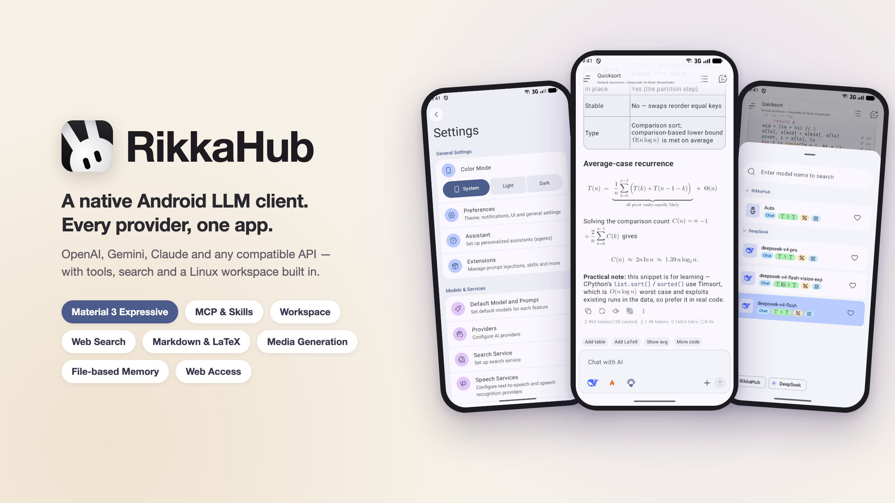

  
  <h1>RikkaHub</h1>

一個原生Android LLM 聊天客戶端，支持切換不同的供應商進行聊天 🤖💬

點擊加入我們的Discord伺服器 👉 [【RikkaHub】](https://discord.gg/9weBqxe5c4)

[English](README.md) | 繁體中文 | [简体中文](README_ZH_CN.md)

  

## 🚀 下載

🔗 [前往官網下載](https://rikka-ai.com/download)（推薦）

🔗 [前往 Google Play 下載](https://play.google.com/store/apps/details?id=me.rerere.rikkahub)

> [!WARNING]
> RikkaHub 存在許多 fork 版本，fork 版本出現問題與 RikkaHub 無關，請謹慎使用 fork 版本，避免隱私洩露或者過度索要權限問題。

## ✨ 功能特色

- 🎨 現代化安卓APP設計（Material 3 Expressive / 預測性返回）和 🌙 暗色模式
- 📦 工作區：基於 proot 的 Linux 智能體環境
- 🎬 媒體生成（圖片、影片）
- 🖥️ Web多端訪問支持
- 🛠️ MCP 與 Skills 支持
- 🔄 多種類型的供應商支持，自定義 API / URL / 模型（目前支持 OpenAI、Google、Anthropic）
- 🖼️ 多模態輸入支持
- 📝 Markdown 渲染（支持代碼高亮、數學公式、表格、Mermaid）
- 🔍 搜尋功能（Exa、Tavily、Zhipu、LinkUp、Brave、Perplexity、..）
- 🧩 Prompt 變量（模型名稱、時間等）
- 🤳 二維碼導出和導入提供商
- 🤖 智能體自定義
- 🧠 基於檔案的記憶
- 📝 AI翻譯
- 🌐 自定義HTTP請求頭和請求體

## ✨ 開發

> [!IMPORTANT]
> 本項目不接受 Pull Request（PR）。

本項目使用[Android Studio](https://developer.android.com/studio)開發。

技術棧文檔:

- [Kotlin](https://kotlinlang.org/) (開發語言)
- [Koin](https://insert-koin.io/) (依賴注入)
- [Jetpack Compose](https://developer.android.com/jetpack/compose) (UI 框架)
- [DataStore](https://developer.android.com/topic/libraries/architecture/datastore?hl=zh-cn#preferences-datastore) (
  偏好數據存儲)
- [Room](https://developer.android.com/training/data-storage/room) (數據庫)
- [Coil](https://coil-kt.github.io/coil/) (圖片加載)
- [Material 3 Expressive](https://m3.material.io/) (UI 設計)
- [Navigation 3](https://developer.android.com/guide/navigation/navigation-3) (導航)
- [Okhttp](https://square.github.io/okhttp/) (HTTP 客戶端)
- [kotlinx.serialization](https://github.com/Kotlin/kotlinx.serialization) (Json序列化)

## 💰 捐贈

* [Ko-fi](https://ko-fi.com/reovodev)
* [愛發電](https://afdian.com/a/reovo)

## ⭐ Star History

如果喜歡這個項目，請給個Star ⭐

<a href="https://www.star-history.com/?type=date&repos=re-ovo%2Frikkahub">
 <picture>
   <source media="(prefers-color-scheme: dark)" srcset="https://api.star-history.com/chart?repos=re-ovo/rikkahub&type=date&theme=dark&legend=top-left&sealed_token=qSytWeq7LkzQQViTjK0MYlvvA_qkfuwjOxOqgbRpLUZZwok5rO6LXhpVL7Mq-q3o89BfKpzE7g66BCy18H6eiqTsD8czD0J-HejLqmHy-npcvCTHu11wZw" />
   <source media="(prefers-color-scheme: light)" srcset="https://api.star-history.com/chart?repos=re-ovo/rikkahub&type=date&legend=top-left&sealed_token=qSytWeq7LkzQQViTjK0MYlvvA_qkfuwjOxOqgbRpLUZZwok5rO6LXhpVL7Mq-q3o89BfKpzE7g66BCy18H6eiqTsD8czD0J-HejLqmHy-npcvCTHu11wZw" />
   
 </picture>
</a>

## 📄 許可證

本項目基於 [GNU Affero General Public License v3.0](LICENSE) (AGPL-3.0) 開源。
